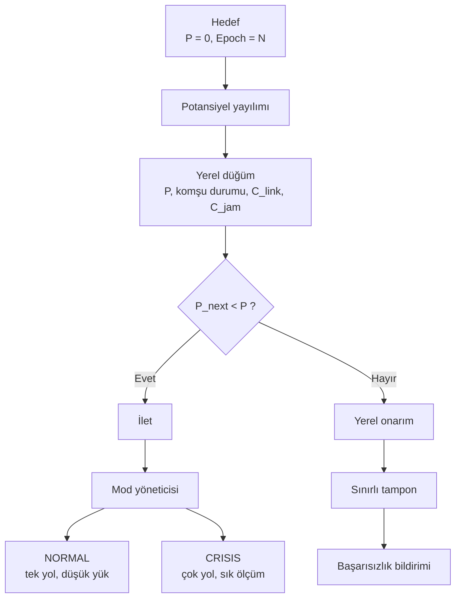
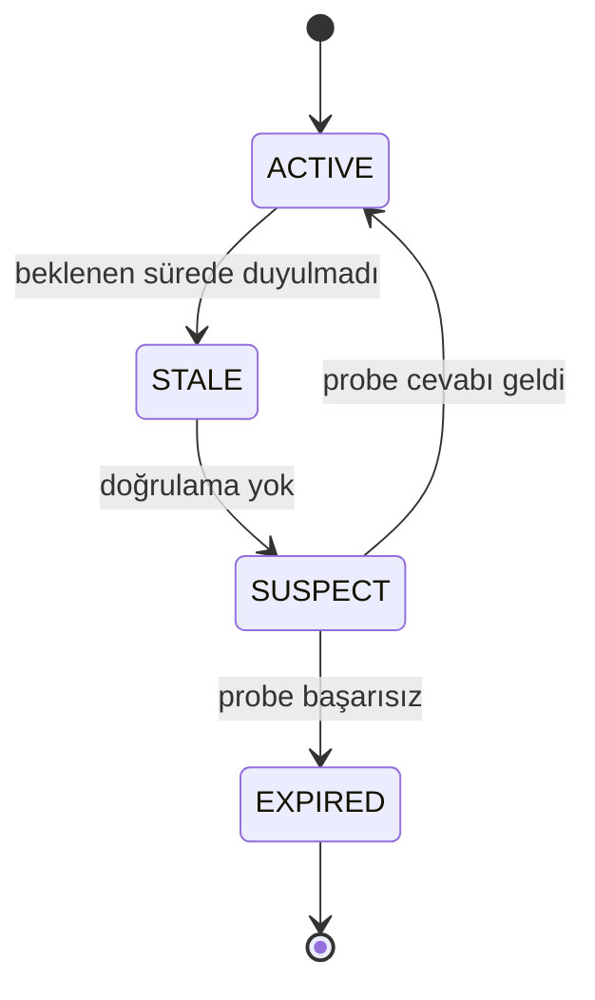

# DESPARETE – Protokol Taslağı v0

2026-09-20 · @Someone

## 1. Amaç ve kapsam

DESPARETE, taktik İHA mesh ağları için tasarlanan, karıştırma (jamming) altında dayanıklı ve normal zamanda sessiz çalışan dağıtık bir yönlendirme protokolü taslağıdır. Bu belge gerçek bir protokol şartnamesi değil, çalışma mantığını kilitleyen bir tasarım taslağıdır.

**Ana fikir:** Hedefe yayılan dağıtık bir maliyet (potansiyel) alanı kurulur, paketler her adımda hedefe daha düşük maliyetli komşuya akar. Karıştırılan bağların maliyeti yükselir ve akış kendiliğinden başka yöne kayar. Ağ normalde tasarruflu (tek yol, az kontrol trafiği), bozulma algılandığında savunmacı (çok yol, sık ölçüm) davranır.

**Temel proje sınırları:**

- İHA'ların fiziksel hareketi protokol tarafından değiştirilmez; hareket yalnızca gözlemlenir.
- Ana problem haberleşme ve yönlendirme davranışıdır.
- En kötü senaryo güçlü karıştırıcıdır.
- Protokol mümkün olduğunca dağıtıktır, merkezi lider veya koordinatör yoktur.
- Kontrol trafiği ve enerji tüketimi gereksiz yere artırılmaz.
- Sistem simülasyonda ölçülebilir ve AODV, OLSR, AOMDV ile karşılaştırılabilir olmalıdır.

**Simülasyon bağlamı:** 40 İHA; yer istasyonu ile iletişim ilk sürümde modellenmiyor.

## 2. Genel mimari

Çekirdek üç parçadan oluşur ve tek bir sistem olarak çalışır: potansiyel alan "nereye gitmeliyim?", mod yöneticisi "ne kadar dayanıklılık ve kontrol trafiği harcamalıyım?", adaptif komşuluk durumu "hangi komşu bilgisine ne kadar güvenebilirim?" sorusunu cevaplar.



NORMAL ve CRISIS ayrı yönlendirme algoritmaları değildir. Aynı yönlendirme motoru, moda göre farklı parametrelerle çalışır. Jamming de ayrı bir algoritma değil, maliyet formülünün bir bileşenidir.

## 3. Potansiyel alan ve yerel yönlendirme

DESPARETE rota tablosuz değildir: klasik next-hop tablosu yerine, hedef başına bir potansiyel (hedefe tahmini toplam iletişim maliyeti) ve komşuların ilan ettiği potansiyeller tutulur. Bu, Bellman-Ford tipi mesafe-vektörü hesabıdır.

```latex
P(i) = \min_{j \in N(i)} \big( P(j) + C(i,j) \big), \qquad P(\text{hedef}) = 0
```

Her düğüm, hedef için kendi potansiyelini ve komşularının ilan ettiği potansiyelleri kullanarak sonraki adımı seçer.

**Yönlendirme kuralları:**

1. Normal iletimde yalnızca P\_next < P\_current olan komşular geçerlidir. Eşit veya yüksek potansiyelli komşu geçersizdir.
2. Eşit maliyette deterministik tie-break uygulanır. Yakın maliyetlerde (örneğin 5.02 ve 5.04) enerji durumu ikincil ölçüt olabilir; belirgin farklarda (5.02 ve 8.90) olmaz.
3. Alan bilgisi epoch taşır; eski epoch yeni epoch'u ezemez (Bölüm 5).
4. Döngü koruması için paket yaşam süresi ve kuyruk sınırı bulunur.

**Yerel minimum meselesi:** Alan tutarlı ve güncelse hedef dışındaki her düğümün daha düşük potansiyelli bir komşusu vardır. Bu yüzden asıl risk çukurlar değil, bayat alan bilgisi, eşzamansız güncellemeler ve dinamik maliyet değişimleridir. Örneğin B'nin maliyeti jamming yüzünden 4'ten 10'a çıkmışken A hâlâ eski 4 değerini görüyorsa A yanlışlıkla B'ye gönderebilir.

## 4. Maliyet modeli

Bir bağın maliyeti üç bileşenden oluşur ve jamming ayrı bir mekanizma değil, bu formülün bir terimidir.

```latex
C(i,j) = C_{hop} + C_{link} + C_{jam}(i,j)
```

| Bileşen | Tanım | Not |
| --- | --- | --- |
| C\_hop | Her bağ için sabit temel maliyet (başlangıçta 1) | Hop sayısı ayrıca ikinci kez cezalandırılmaz |
| C\_link | ETX benzeri bağ kalitesi | Yalnızca RSSI yetmez (RSSI iyi, PDR kötü olabilir); ilk sürümde C\_link = f(PDR) ile başlanabilir |
| C\_jam(i,j) | Bağa özgü karıştırma cezası | Normalde ≈ 0, bozulmada yükselir |

**C\_jam link-yerel bir gözlemdir.** "B bölgesinde jammer var" diye global bir duyuru yapılmaz, çünkü bu duyuru karıştırılan kanaldan geçmek zorunda kalırdı. Bunun yerine A, B'ye gönderirken kendi ölçtüğü PDR düşüşü, SINR bozulması, ACK başarısızlığı ve yeniden iletim artışına bakarak C\_jam(A,B) değerini yükseltir. A-B bağı pahalılaşırken A-E bağı sağlamsa akış oraya kayar.

**Enerji ilk sürümde ana maliyette yer almaz.** Enerjiyi ana metrik yapmak enerji güncellemesi, alan güncellemesi ve rota değişimi arasında gereksiz bir salınım döngüsü yaratabilir. Enerji yalnızca yakın maliyetler arasında ikincil tercih olarak kullanılır.

**Açık nokta:** PDR, SINR ve yeniden iletim ölçümlerinin tek bir C\_jam değerine hangi fonksiyonla dönüştürüleceği ve normalize edileceği henüz belirlenmedi.

## 5. Field epoch ve tazelik

Epoch'u hedef üretir; böylece saat senkronizasyonu gerekmez. Hedef alanı Epoch = 17 ile başlatır, alan geçersizleşince Epoch = 18 yayar. Düğümler (epoch, potansiyel) çiftini birlikte değerlendirir. Bu yaklaşım AODV ve DSDV'deki hedef sıra numarası ailesiyle, Babel'in feasibility mekanizmasıyla akrabadır.

**Alan güncelleme ilkesi:**

- Taze ve geçerli bilgiyle gelen maliyet düşüşleri hızlıca kullanılabilir.
- Maliyet artışları yeni bir field epoch'u ile ilişkilendirilmeli ve tazelik doğrulamasından geçmelidir.
- Düğüm, daha yeni alan bilgisini daha eski bir ilanla ezemez.

**Soft-state:** Alan kalıcı bir tablo değildir. Her alan için epoch, yaş ve geçerlilik süresi (VALID\_UNTIL) tutulur. Normalde alan istek üzerine (reaktif) kurulur, ihtiyaç oldukça güncellenir ve veri trafiğine piggyback ile eklenebilir. CRISIS'te daha sık tazelenir. Akış: kaynağın hedef için geçerli alanı yoksa FIELD\_INITIATE ile alan yayılır, sonra iletim başlar.

**Dürüst çerçeve:** Bu mekanizma count-to-infinity sorununu "çözmez", sınırlandırır. DESPARETE dinamik maliyet artışlarının distance-vector ailesindeki bayat rota ve döngü davranışlarına açık olduğunu kabul eder ve bunu freshness ile sıra numarası mekanizmasıyla kontrol eder.

## 6. Adaptif komşuluk durumu

HELLO tamamen kaldırılmaz, gerektiğinde gönderilir: normalde pasif dinleme (overhearing), bilgi yaşlandığında beacon veya probe, CRISIS'te daha sık ölçüm. Komşuluk ikili (var/yok) değil, yumuşak bir durum makinesidir.



| Durum | Anlamı | NORMAL'de kullanım | CRISIS'te kullanım |
| --- | --- | --- | --- |
| ACTIVE | Yakın zamanda duyuldu, potansiyeli güvenilir | Evet | Evet |
| STALE | Beklenen sürede duyulmadı, yaşa bağlı ceza eklenir | Tercihen hayır, son çare | Ceza ile kullanılabilir |
| SUSPECT | Güvenilirliği düşük | Probe | Probe |
| EXPIRED | Artık kullanılmaz, önbellekten çıkarılır | Hayır | Hayır |

**Piggyback potansiyel:** DATA paketi gönderenin kimliğini, hedefi, field epoch'unu ve o hedef için kendi potansiyelini taşır. Bir komşu bu paketi duyduğunda hem "gönderen hâlâ menzilde" hem "gönderenin potansiyeli şu" bilgisini tek paketten alır.

**Süreler sabit değildir.** ACTIVE'den STALE'e geçiş süresi, mevcut hız, yön ve mesafeden tahmin edilen bağ ömrüne bağlıdır: yavaş ve stabil komşu için uzun, hızla uzaklaşan komşu için kısa. Bu, hareket kontrolü değil hareket gözlemidir.

## 7. Mod yöneticisi: NORMAL ve CRISIS

Her düğüm kendi gözlemleriyle NORMAL veya CRISIS moduna karar verir; CRISIS ikinci bir yönlendirme algoritması değil, aynı motorun daha savunmacı parametreli halidir.

|  | NORMAL | CRISIS |
| --- | --- | --- |
| Sonraki adım | En düşük potansiyelli tek komşu | Uygun ilk iki komşu (P\_next < P\_current) |
| Kontrol trafiği | Az, pasif gözlem | Sık ölçüm, sık beacon ve probe |
| Alan tazeleme | Yavaş | Hızlı |
| Jamming cezası | Standart | Daha ağır |
| Veri çoğaltma | Yok | Yalnızca kritik sınıflar |

**CrisisScore:** Tek metrikli (yalnızca PDR) kural kullanılmaz, çünkü kayıp collision, tıkanıklık, hareket veya jamming kaynaklı olabilir. İlk sürümde iki gösterge yeterlidir; ileride ETX bozulması, SINR/SJR, kanal meşgul süresi, RSSI-PDR tutarsızlığı eklenebilir.

```latex
CrisisScore = w_{loss} \cdot loss + w_{neighbor} \cdot neighbor\_instability
```

**Yerel-öncelikli karar:** Kriz global ilan edilmez. Düğüm A CRISIS'e girince MODE\_NOTICE yayar; komşular bunu emir değil ek kanıt sayar. Karar: komşu kanıtı + kendi kanıtım = kendi modum.

**Histerezis:** Giriş ve çıkış eşikleri ayrıdır (TH\_ENTER > TH\_EXIT). Taslak değerler TH\_ENTER = 0.60, TH\_EXIT = 0.25 örnek olup simülasyonla kalibre edilecektir. Girişte ardışık 3 kötü pencere, çıkışta 5 iyi pencere aranır, ayrıca minimum kriz süresi (MIN\_CRISIS\_DURATION) tutulur. Belirgin, katastrofik bir bağ kaybında doğrudan CRISIS'e geçilebilir.

## 8. Crisis multipath, çoğaltma ve yerel onarım

CRISIS'te tek yol yerine birden fazla uygun sonraki adım kullanılır, ancak her şey çoğaltılmaz.

**Multipath:** İlk sürümde "en iyi sonraki adım + ikinci uygun sonraki adım" yeterlidir. Yerel seçim gerçek düğüm-ayrık veya bağ-ayrık yol garantisi vermez (A-B-D ve A-C-D ayrık görünse de üst akış ortak olabilir), bu yüzden ayrıklık zorunlu kural değildir. Yol bağımsızlığı ve korelasyon ölçümü ileri sürüme bırakılır.

**Seçici çoğaltma:**

| Trafik sınıfı | CRISIS'te |
| --- | --- |
| Kontrol / kritik | Çoğalt |
| Görev verisi | Çoğalt |
| Telemetri | Tek yol |
| Düşük öncelikli | Tek yol |

**Yerel onarım:** Daha düşük potansiyelli komşu bulunamazsa paket geri gönderilmez (C→B→A gibi tersine gönderim döngü üretir). Bunun yerine:


Tampon sınırlıdır (T\_BUFFER süresi, MAX\_QUEUE boyutu); sınırsız bekleme ve yeniden deneme yoktur.

## 9. Paket sınıfları

Protokol iki wire-level sınıfa sahiptir: DESPARETE\_DATA ve DESPARETE\_CONTROL; kontrol paketlerinin alt tipleri vardır. Alan listeleri örnektir, minimum header yapısı sonraki aşamada netleşecek.

| Paket | Ne zaman | Örnek alanlar |
| --- | --- | --- |
| DATA | Veri iletimi | Kaynak, hedef, field epoch, gönderenin potansiyeli, trafik sınıfı, TTL |
| FIELD\_UPDATE | Alan yayılımı ve tazeleme | Hedef ID, field epoch, potansiyel, gönderen ID, yaş |
| MODE\_NOTICE | Düğüm CRISIS'e girip çıkınca | Düğüm ID, mod, field epoch, CrisisScore, neden, zaman |
| PROBE | SUSPECT komşuyu doğrulama | Gönderen ID, hedef komşu ID |
| FIELD\_REQUEST | Geçerli alan yok veya bayat | Hedef ID, son bilinen epoch |
| DELIVERY\_FAILURE | Tampon süresi veya kuyruk aşıldı | Hedef ID, kaynak, neden |

## 10. Hedef deseni ve simülasyon planı

V1 simülasyonu sink odaklı trafik kullanır: bir birincil sink ve isteğe bağlı ikincil sink. Herkesin herkese göndermesi 40 ayrı alan gerektirir ve sonuçları protokolün kendisinden çok "kaç alan tutuluyor" etkisi domine eder. Çoklu hedef, stres testi olarak sonraya bırakılır.

**Kurulum:** 40 İHA, hareket gözlemlenir ama kontrol edilmez, yer istasyonu haberleşmesi modellenmez, en kötü senaryo güçlü karıştırıcıdır.

**Karşılaştırma (baseline):** AODV, OLSR, AOMDV.

**Önerilen metrikler:**

- Paket teslim oranı (PDR)
- Uçtan uca gecikme
- Kontrol trafiği yükü ve enerji tüketimi
- Karıştırıcı sonrası toparlanma süresi
- Mod değiştirme sayısı (flapping göstergesi)
- Yanlış CRISIS oranı (jammer yokken CRISIS'e girme)

**Önerilen deney senaryoları:** jammer yok, sabit jammer, hareketli jammer, kısmi düğüm kaybı, yoğun trafik (tıkanıklık, jamming ile karışmasın diye ayrı).

## 11. Elenen ve ertelenen özellikler

Değerlendirilen yedi fikirden üçü çekirdeğe girdi, biri adaptif komşuluğa dönüştü, üçü ilk sürümden çıkarıldı veya ertelendi.

| Fikir | Karar | Gerekçe |
| --- | --- | --- |
| Potansiyel alan / su akışı | Çekirdek | Ana yönlendirme mekanizması |
| NORMAL / CRISIS modu | Çekirdek | Dayanıklılık ve enerji politikasını yönetir |
| Hello'suz komşu keşfi | Dönüştürüldü | Adaptif komşuluk durumu ve piggyback potansiyel olarak korundu |
| Yay modeli (fiziksel düzeltme) | Çıkarıldı | İHA hareketini değiştirmeyi gerektirir, proje sınırı dışı |
| Veri parçalama / kodlama | Çıkarıldı | Veri katmanı karmaşıklığı getirir, çekirdeği gölgeler; CRISIS'te çoklu yol ve seçici çoğaltma yeterli |
| Hayalet lider | Çıkarıldı | Dağıtık yönlendirmeye gereksiz koordinasyon katmanı ekler, zaman senkronizasyonu sorunu getirir |
| İtibar tabanlı rota | Geleceğe bırakıldı | Jamming kaynaklı kayıp ile kötü niyetli düşürmeyi ayırt etmek zor, yanlış pozitif riski yüksek |

## 12. Literatür konumlandırma

DESPARETE yeni bir gradyan yönlendirme algoritması olduğunu iddia etmez; Bellman-Ford tabanlı distance-vector ailesinin (DSDV, AODV, Babel) üzerine kurulur. Özgünlük iddiası kombinasyondadır:

- Bağa özgü, gönderen tarafından ölçülen jamming-aware maliyet (C\_jam)
- Adaptif komşuluk yaşlandırması ve piggyback potansiyel yayılımı
- Yerel-öncelikli ve histerezisli CRISIS modu
- CRISIS'te seçici multipath ve seçici çoğaltma
- Hareket kontrolü olmadan yalnızca hareket gözlemi

**Kaynaklar (yazı hazırlanırken bağlantıların içeriği doğrulanmalı):**

- [RFC 6126: Babel yönlendirme protokolü](https://www.rfc-editor.org/rfc/rfc6126.html)
- [RFC 3561: AODV](https://www.rfc-editor.org/rfc/rfc3561.html)
- [Adaptif HELLO / beacon çalışması (IEEE)](https://ieeexplore.ieee.org/document/9762739)
- [UAV ağlarında girişim farkındalıklı potansiyel alan yönlendirmesi](https://www.minicod.com/papers/interference-aware-multihop-routing-in-uav-networks-a-harmonic-function-based-potential-field-approach-42d109c2)
- [Watchdog / itibar yaklaşımı ve yanlış pozitifler](https://www.acadlore.com/article/IJCMEM/2025_13_4/ijcmem130414)

## 13. Açık sorular ve sonraki adımlar

Mimari kilitlendi; kalan iş parametrelerin ve fonksiyonların netleştirilmesi. Önce mimariyi etkileyen iki büyük konu çözülmeli:

1. **C\_jam formülü:** PDR, SINR ve yeniden iletim ölçümleri hangi fonksiyonla tek bir maliyete dönüşecek ve nasıl normalize edilecek?
2. **Maliyet artışında alan güncellemesi:** Hangi düğüm ne zaman yeni epoch bilgisi yayacak, hangi düğüm eski alanı ne zaman terk edecek?

**Diğer açık kararlar:**

- C\_link formülü (ETX veya f(PDR))
- P\_next < P\_current kuralının istisnasız olup olmadığı ve tie-break yöntemi
- Alanın istek üzerine mi hafif proaktif mi kurulacağı ve alan tazeleme tetikleyicileri
- ACTIVE→STALE→SUSPECT→EXPIRED geçiş süreleri ve probe timeout
- CrisisScore girdileri, ağırlıkları, TH\_ENTER ve TH\_EXIT değerleri, pencere sayıları
- CRISIS'te kullanılacak yol sayısı ve çoğaltılacak veri sınıfları
- Tampon süresi ve boyutu
- Kontrol paketlerinin minimum header yapısı

**Önerilen sıra:** (1) C\_jam ve alan güncelleme davranışını kilitle, (2) v0 karar tablosunu varsayılan parametrelerle çıkar, (3) basit bir simülasyonda (Python veya ns-3) AODV, OLSR ve AOMDV ile karşılaştır, (4) sonuçlara göre eşikleri kalibre et.
